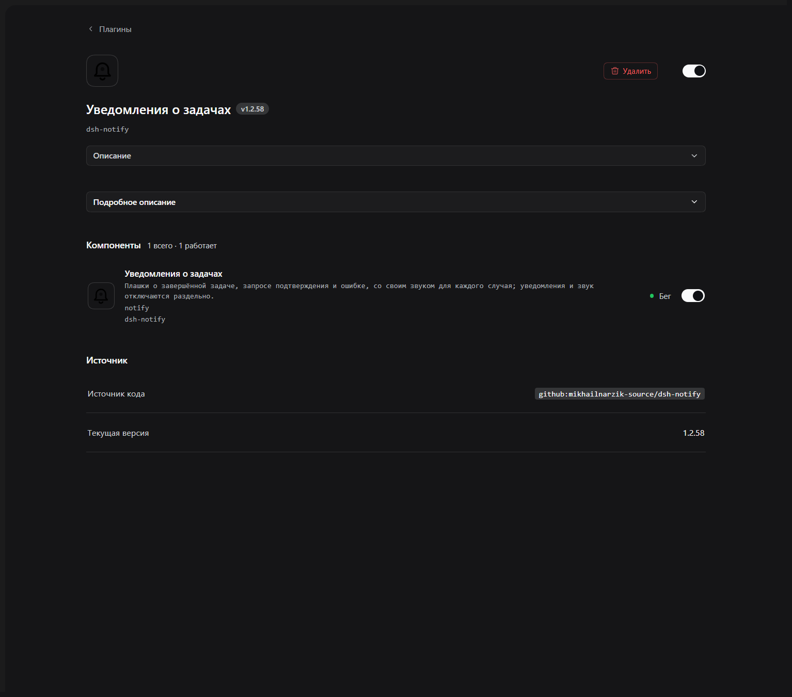

# dsh-notify

Плагин для [DeepSeek Harness](https://github.com/deepseek-ai): показывает
всплывающие карточки (тосты) о том, что произошло в фоновой задаче, и звуком
зовёт вас, если вы ушли в другое окно.



*Страница плагина в интерфейсе DSH.*

## Что это и зачем

DSH выполняет задачу несколько минут. Вы в это время читаете документ, правите
код в другом окне или отошли. Плагин сообщает о трёх событиях:

- **Задача завершена** — зелёная плашка с названием сессии и временем работы.
- **Нужно ваше действие** — жёлтая: агент просит подтвердить вызов инструмента,
  ждёт ответа на вопрос, проверки плана или разрешения после остановки хода.
- **Ошибка** — красная: ход сорвался или ответ оборван по лимиту длины.

Несколько терминов простыми словами:

- **тост (плашка)** — небольшое окошко в углу поверх интерфейса, исчезает само;
- **сессия** — один диалог в DSH, он выбран в списке слева;
- **фокус** — окно, в котором вы работаете прямо сейчас; «не в фокусе» значит
  «свёрнуто или закрыто другим окном»;
- **игровой режим** — режим тишины: плашки не показываются, звук остаётся.

Зачем это нужно: не проверять окно Harness каждые полминуты. Когда задача
закончится или агенту понадобится ваше решение, вы услышите звук и увидите
плашку.

## Как открыть

1. Нажмите **Настройки** (шестерёнка в интерфейсе DSH).
2. В списке разделов настроек выберите **«Уведомления»** — у него иконка
   **колокольчика**. Здесь всё: плашки, звук, тема, проверка и история.
3. В **«Настройки → Плагины»** найдите карточку **«Уведомления о задачах»** —
   она тоже отмечена колокольчиком. В карточке описание, версия и кнопка
   «Подробнее»: она открывает `docs/DETAIL.md` — подробную версию этого
   руководства.
4. Плашки появляются сами, когда происходит событие. Отдельно включать их не
   нужно — они включены по умолчанию.

Ещё один вход — **собственная панель в левой панели**: если она закреплена,
нажмите **«Уведомления»** с колокольчиком — откроется та же страница настроек,
но без описания плагина, источника и версии. Открепили панель? Она осталась в
меню **«Ещё»** внизу левой панели — там её можно закрепить обратно. Видимость и
закрепление панелей настраиваются в плагине **«Оформление интерфейса»**.

## Как пользоваться пошагово

Сценарий: «узнать, что задача закончилась, пока я в другом окне».

1. Откройте **Настройки → Уведомления**.
2. Проверьте переключатели: «Показывать уведомления» — включён, «Звуковые
   уведомления» — включён, «Громкость» — не на нуле (по умолчанию 90%).
3. Прокрутите до раздела **«Проверка»** и нажмите **«Завершение»**.
   **Что вы увидите:** в углу окна появится зелёная плашка «Задача завершена»
   и прозвучит мягкий сигнал. Это значит, что всё работает.
4. Вернитесь в чат, дайте агенту короткое задание и переключитесь в другую
   сессию (или сверните окно Harness), пока он работает.
5. Когда агент закончит, в углу появится плашка «Задача завершена» и прозвучит
   звук. Если окно Harness свёрнуто, на Windows появится карточка поверх всех
   окон.
6. Нажмите на плашке **«Перейти»** — Harness поднимется и откроет нужную
   сессию. Плашка при этом закроется сама.

Дальше можно ничего не настраивать: плагин работает и с настройками по
умолчанию. Оформление и звук меняются в том же разделе в любой момент.

## Примеры

Команды агенту (просто напишите их в чат):

| Команда | Что увидите |
| --- | --- |
| «Собери список файлов в src и подожди моего подтверждения перед удалением» | жёлтую плашку «Нужно ваше действие» |
| «Запусти тесты и вернись с результатом» | зелёную плашку по завершении |
| «Запусти двух субагентов: один делает ревью, второй пишет тесты» | отдельные плашки о завершении каждого помощника с бейджем «субагент» |
| «Сделай ревью и сразу правь, если уверен» | при ошибке — красную плашку «Произошла ошибка» |

Полезные настройки:

| Настройка | Зачем менять |
| --- | --- |
| «Сколько висит» → «Не скрывать» | плашка останется, пока вы её не закроете |
| «Форма плашки» → «Строка» | компактнее, если экран маленький |
| «Угол экрана» | перенести плашки туда, где они не мешают |
| «Игровой режим» → включить | не перекрывать игру; звук останется |
| «Показывать в системе» | уведомление Windows, когда Harness не в фокусе |

## Что вы увидите

Страница «Уведомлений» оформлена в общем стиле плагинов DSH: по центру колонка
шириной до 960 px, сверху шапка с иконкой 🔔, названием, подзаголовком, чипом
(«Плашки включены» или «Плашки выключены») и кнопкой «Обновить» — она
перечитывает настройки и историю. Ниже — карточки-секции: «Обновления»,
«Оформление», «Показ уведомлений», «Звук», «Системные уведомления»,
«Предпросмотр» и «История»; на узком окне они выстраиваются в одну колонку.

**Чип статуса — как кнопка.** Чип «Плашки включены» / «Плашки выключены» в шапке
оформлен как кнопка, а не пилюля: height 32 px, радиус 10 px, `padding: 0 12px`,
рамка 1 px, шрифт 600 12.5, точка-индикатор 6 px слева, мягкая заливка токеном
(success — включены, muted — выключены). Счётчик «×N» на плашке и метка вида
(«ЗАДАЧА», «ОШИБКА») тоже получили кнопочную форму: радиус 10 px и рамку 1 px;
в плашке они компактные (высота 22 px), чтобы не растягивать строку заголовка.

Плашка показывается, только если вы не читаете именно ту сессию, где произошло
событие, или окно приложения не в фокусе; звук при этом звучит всегда. Когда вы
открываете сессию, о которой сообщила плашка, она закрывается сама.

**Плашка (тост).** Цветная полоса и иконка слева, заголовок («Задача
завершена», «Нужно ваше действие», «Произошла ошибка»), ниже — название сессии
и время работы, например «за 2 мин». Внизу тонкая полоса: она медленно
сокращается — это таймер обратного отсчёта до автоматического скрытия.

**Кнопки на плашке.** «Перейти» открывает нужную сессию. Круглый **✕** просто
закрывает плашку. Кнопка с колокольчиком выключает звук на 15 минут; когда
звук приглушён, колокольчик перечёркнут, а повторное нажатие возвращает звук.

**Колокольчик.** Это «лицо» плагина: иконка у раздела «Уведомления» в
настройках и у карточки плагина в списке «Плагины». Внутри плашки колокольчик
показывает состояние звука (обычный / перечёркнутый).

**Карточка.** Слово означает две разные вещи, обе описаны ниже.

- **Форма плашки «Карточка»** — один из трёх видов плашки: «Строка» (одна
  строка), «Карточка» (заголовок и подробности), «Полоса» (широкая лента).
  Выбирается в «Оформление → Форма плашки»; рядом сразу виден живой
  предпросмотр.
- **Карточка поверх всех окон** (Windows) — отдельное окно, которое видно
  поверх любых программ, когда Harness свёрнут. В ней те же «Перейти» и **✕**,
  внизу время и таймер «висит 0:25», а кнопка звука при приглушении показывает
  обратный отсчёт вида «14:59». Проверить её можно в настройках: «Проверка →
  Поверх всех окон → Показать».

**Таймер.** В настройке «Сколько висит» выбирается 4 с, 6 с, 10 с или «Не
скрывать». На плашке таймер показан полосой внизу, на карточке поверх всех
окон — строкой «висит 0:05». У приглушённого звука свой таймер: сколько минут
осталось до его возвращения.

**Игровой режим.** Переключатель в разделе «Показ уведомлений». Когда он
включён, не показываются ни плашки, ни карточки поверх окон, ни системные
уведомления Windows — ничего не перекрывает игру. Звук при этом остаётся:
сигнал вы услышите, а картинку игра не потеряет. Выключите режим — плашки
вернутся.

**История.** Раздел «Недавние» в настройках хранит 10 последних уведомлений:
тип, текст и время. Клик по записи открывает связанную сессию, кнопка
«Очистить» стирает список.

**Обновления.** В начале настроек раздел «Обновления»: установленная версия,
статус проверки, кнопка «Проверить обновления» и — когда есть новая версия —
«Установить обновление».

## Частые ошибки и что делать

| Симптом | Причина | Что сделать |
| --- | --- | --- |
| Плашек нет совсем | выключен «Показывать уведомления» или включён «Игровой режим» | включить плашки и выключить игровой режим в настройках |
| Плашка есть, звука нет | выключен звук, громкость на нуле или звук приглушён на 15 минут | проверить «Звуковые уведомления», «Громкость», нажать колокольчик для возврата звука |
| Звук молчит в фоновой вкладке браузера | браузер не играет звук, пока в окне не было действия пользователя | один раз кликнуть или нажать клавишу в окне Harness — звук разблокируется |
| Нет карточки поверх всех окон | не Windows или окно Harness в фокусе | карточка доступна на Windows и показывается, когда окно не в фокусе; в фокусе вместо неё обычная плашка |
| Нет уведомлений Windows | не выдано разрешение браузера или мешает полноэкранная игра | включить «Показывать в системе» и нажать «Разрешить»; в игре — «Игровой режим» |
| Две одинаковые ошибки показались одной плашкой | плагин склеивает повторы за несколько секунд | это задумано, чтобы не заваливать экран |
| «Harness не ответил», версия показана как «—» | в трее остался старый процесс DSH | полностью закрыть Harness (иконка в трее → «Выход») и запустить снова |
| После обновления ничего не изменилось | новая версия подхватывается при старте | перезапустить DeepSeek Harness |

## Ограничения и безопасность

- Плашки рисуются внутри окна Harness. Выше окон других программ поднимается
  только отдельная карточка, и только на Windows.
- Совсем без запущенного Harness уведомлений не будет: карточку запускает
  процесс приложения. Если Harness открыт только во вкладке браузера,
  поднимается эта вкладка.
- Звуки синтезируются в браузере (файлов нет), поэтому браузеру нужно хотя бы
  одно действие пользователя в окне.
- Данные: настройки хранятся в профиле (`dsh-notify/settings.json`, копия — в
  localStorage), история — в localStorage (10 записей), журнал событий —
  `~/.dsh/dsh-notify/log.jsonl`. В модель и в логи сессий плагин ничего не
  пишет: только короткие записи о том, что событие было.
- Сеть нужна только для проверки обновлений на GitHub.
- Плагин личный, без гарантий; код можно брать и переделывать под себя.

Что нужно для работы: DeepSeek Harness 0.2.x с веб-клиентом, браузер с
WebAudio, для системных уведомлений — разрешение браузера. Внешних зависимостей
и шага сборки нет.

## Связанные плагины

- **dsh-team** — панель «Команда» готовит задание для нескольких помощников;
  когда они закончат, dsh-notify сообщит об этом, в том числе с бейджем
  «субагент».
- **dsh-review** — ревью изменений и создание PR; уведомления напомнят о
  результате, пока вы в другом окне.
- **dsh-compact** — сжатие длинного диалога в короткую выжимку; удобно, когда
  сессия разрослась.
- **dsh-sync** — синхронизация истории сессий между устройствами.
- **dsh-polish** — единое оформление кнопок и полей у всех плагинов.

## Установка, обновление и удаление

Установка через интерфейс (рекомендуется):

1. Откройте **Настройки → Плагины**.
2. В поле установки плагина вставьте адрес репозитория:

   ```
   https://github.com/mikhailnarzik-source/dsh-notify
   ```

3. Нажмите установить и дождитесь окончания.
4. Перезапустите Harness, если интерфейс попросит.

Короткая форма той же спецификации: `github:mikhailnarzik-source/dsh-notify`.
Репозиторий публичный: менеджер плагинов проверяет его до установки, а
приватный на новом компьютере потребовал бы настроенного доступа к GitHub.

Установка из локальной копии (удобно для правок):

```powershell
git clone https://github.com/mikhailnarzik-source/dsh-notify.git
cd dsh-notify
dsh plugin --profile desktop add "link:$PWD"
```

Дальше — перезапуск Harness.

Обновление: плагин обновляет себя сам. При запуске Harness и далее раз в
несколько часов host-часть сверяет версию с `package.json` в репозитории на
GitHub. Если вышла новая версия, в углу появляется плашка «Доступно
обновление» с кнопкой «Обновить», а в настройках — раздел «Обновления».
Установка скачивает файлы релиза и атомарно заменяет ими файлы плагина; новый
код начинает работать после перезапуска Harness. Менеджер плагинов обновляет
только пакеты из npm, поэтому кнопки обновления в нём нет — её заменяет
собственная проверка плагина.

При установке через `link:` файлы плагина лежат в отдельной папке, и
пересборка `node_modules` при установке других плагинов их не трогает.

Удаление: **Настройки → Плагины** → у карточки «Уведомления о задачах» кнопка
удаления. Или из терминала:

```powershell
dsh plugin --profile desktop remove dsh-notify
```

## Прокрутка страниц

Уведомления: корень `.dsh-ntf-settings` (ограниченная высота, flex-колонка) и внутренний scroll-контейнер `.dsh-ntf-settings-scroll` прокручивается по вертикали, если контент выше окна. Корень не имеет фиксированной высоты в px:
`height:100%; min-height:0` с внутренним контейнером `flex:1; min-height:0; overflow:auto; overscroll-behavior:contain`, нижний отступ контента не меньше 40 px.

Проверено headless на высотах окна 700/800 px и ширинах 1280/1024/768/480 px: страница докручивается до последнего элемента (`bottomReachable`), горизонтальной прокрутки страницы нет.

Тест: `node --test test/scroll.test.mjs`.
