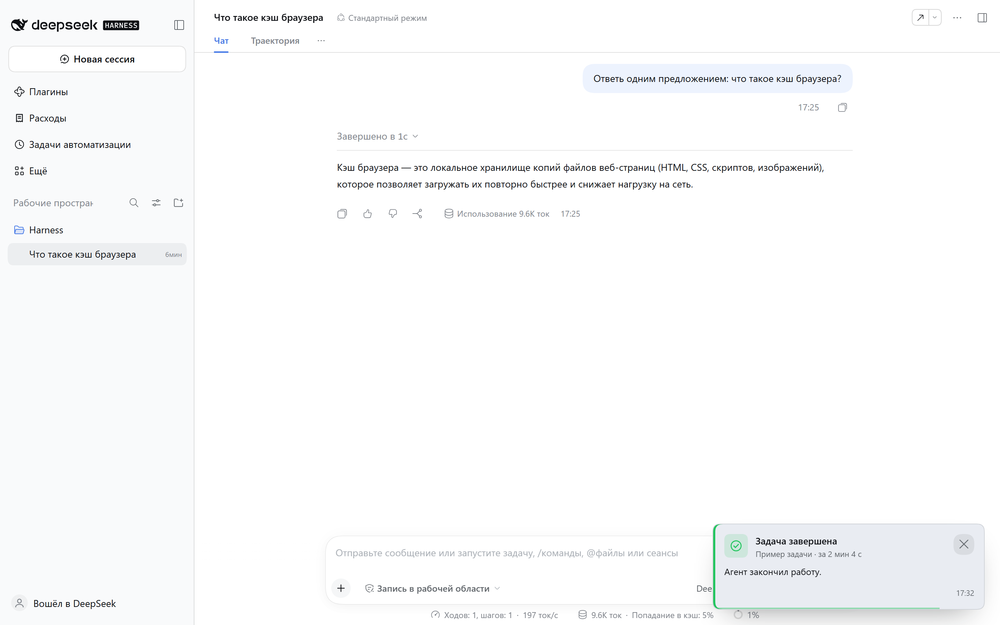
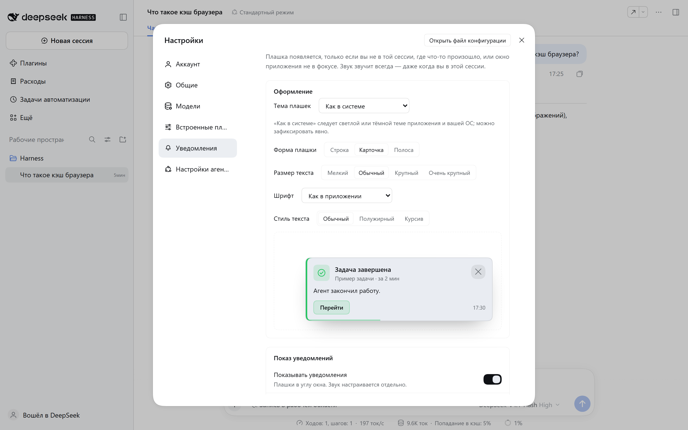

# dsh-notify

Уведомления в стиле десктопных приложений для [DeepSeek Harness](https://github.com/deepseek-ai):
зелёный тост, когда агент закончил задачу, жёлтый — когда он ждёт вашего
действия, красный — когда ход сорвался. У каждого свой звук и свои настройки.

Плагин личный, но устроен как обычный bundle DSH: ставится из интерфейса,
обновляется переустановкой, удаляется одной кнопкой.



*Плашка появляется поверх панели приложения; у неё есть кнопка «Перейти» и
крестик, звук синтезируется на месте.*



*В настройках — тема, форма, типографика и живой предпросмотр плашки, а также
история последних уведомлений.*

## Что показывает

- **Задача завершена** — зелёный тост с названием сессии и временем работы.
- **Нужно ваше действие** — жёлтый: подтверждение вызова инструмента, вопрос по
  плану, запрос разрешения, остановка хода.
- **Ошибка** — красный: сбой хода или обрыв ответа по лимиту длины.
- **История** последних уведомлений — прямо в настройках плагина.

Тост показывается, только если вы не читаете именно ту сессию, где произошло
событие, или окно приложения не в фокусе. Звук звучит всегда — даже когда вы в
этой сессии. При переходе в сессию из уведомления его тост закрывается сам;
переход в другую сессию или закрытие окна приложения тост не закрывает.

## Оформление

Плашки нарисованы в современном, но спокойном стиле: мягкий радиус, тонкая
рамка, акцентная полоса слева, иконка в цветной подложке, аккуратная кнопка
«Перейти» и круглый крестик. Геометрия слегка различается для Windows и macOS,
а цвета берутся из темы приложения.

В настройках есть выпадающий список **«Тема плашек»**: «Как в системе»,
«Тёмная», «Светлая». «Как в системе» следует светлой или тёмной теме приложения
и вашей ОС; явный выбор фиксирует палитру, в том числе для нативной карточки
поверх всех окон.

Под списком сразу показан **живой предпросмотр**: он отражает все настройки,
которые меняют внешний вид плашки, — тему, форму (строка, карточка, полоса),
угол экрана (плашка в макете встаёт в выбранный угол), время показа (полоса
отсчёта внизу) и типографику: **размер текста**, **шрифт** и **стиль текста**
(обычный, полужирный, курсив). Ничего применять не нужно — как выглядит в
макете, так и будет на экране.

## Поверх всех приложений

Когда Harness не в фокусе (свёрнут или за другими окнами), на Windows
открывается отдельная всегда-сверху карточка — она видна поверх любых
программ, а не только внутри Harness. В карточке две кнопки: **«Перейти»**
поднимает окно Harness и открывает нужную сессию, круглый **✕** справа сверху
просто закрывает уведомление. Карточка рисуется в выбранной теме и том же
стиле, что и плашка в приложении.

«Перейти» находит именно окно приложения Harness: оно поднимается, даже если
свёрнуто или закрыто в трей, а браузер или проводник с похожим заголовком
больше не перехватывают нажатие. Если Harness запущен только во вкладке
браузера, поднимается эта вкладка.

Если нативная карточка недоступна (не Windows или не удалось запустить
компаньон), плагин откатывается к обычной плашке и системному уведомлению
Windows/macOS. Совсем без запущенного Harness уведомлений не будет: карточку
запускает процесс приложения.

В «Настройках → Уведомления → Проверка» есть кнопка **«Поверх всех окон»**:
она показывает такую карточку, даже когда Harness в фокусе.

Повторы одной и той же ошибки в пределах нескольких секунд склеиваются в одно
уведомление, чтобы не заваливать экран.

## Требования

- DeepSeek Harness 0.2.x с веб-клиентом (проверено на 0.2.2-rc.1).
- Браузер с WebAudio (звук синтезируется на месте, файлов нет) и, для системных
  уведомлений, разрешение на них.
- Внешних зависимостей и шага сборки нет: чистый ESM, React даёт хост.

## Установка через интерфейс (рекомендуется)

1. Откройте DeepSeek Harness → боковая панель → **Плагины**.
2. В поле установки плагина вставьте адрес репозитория:

   ```
   https://github.com/mikhailnarzik-source/dsh-notify
   ```

3. Нажмите установить и дождитесь окончания.
4. Перезапустите Harness, если интерфейс попросит.

Короткая форма той же спецификации: `github:mikhailnarzik-source/dsh-notify`.

Репозиторий публичный специально: менеджер плагинов проверяет репозиторий до
установки, отключив запросы паролей, — приватный на новом компьютере потребует
настроенного доступа к GitHub.

## Установка из локальной копии

```powershell
git clone https://github.com/mikhailnarzik-source/dsh-notify.git
cd dsh-notify
dsh plugin --profile desktop add "link:$PWD"
```

Дальше — перезапуск Harness.

## Настройки

Раздел уведомлений в «Настройках» Harness:

| Настройка | Значения |
| --- | --- |
| Уведомления | включены / выключены (отдельно от звука) |
| Звук | включён / выключен, громкость 0–100 |
| Форма плашки | строка (`compact`), карточка (`card`), полоса (`banner`) |
| Угол экрана | правый-нижний, левый-нижний, правый-верхний, левый-верхний |
| Время показа | 4 с, 6 с, 10 с, не скрывать |
| Тема плашек | как в системе / тёмная / светлая |
| Размер текста | 12, 13, 15, 17 px (мелкий, обычный, крупный, очень крупный) |
| Шрифт | как в приложении, без засечек, с засечками, моноширинный |
| Стиль текста | обычный, полужирный, курсив |
| Предпросмотр | живая карточка под настройками, повторяет тему, форму, шрифт и угол |
| Игровой режим | плашки и системные уведомления не показываются, чтобы не перекрывать игру; звук остаётся |
| Системные уведомления | через Notification API браузера, когда окно приложения не в фокусе |
| Проверка «Поверх всех окон» | показать нативную карточку поверх других приложений (Windows) |

Тост рисуется в оверлее поверх всей панели приложения. Выше окон других
программ браузерная плашка подняться не может — для этого есть системные
уведомления Windows (в полноэкранной игре Windows может их скрыть, тогда
включайте игровой режим).

Настройки и история лежат в `localStorage` (`dsh-notify:settings:v1`,
`dsh-notify:history:v1`), поэтому на другом компьютере начнутся со значений по
умолчанию.

## Удаление

**Плагины** → у `dsh-notify` кнопка удаления. Или вручную:

```powershell
dsh plugin --profile desktop remove dsh-notify
```

## Проверка, что работает

1. В «Настройках» появился раздел уведомлений.
2. Дайте агенту короткое задание — по завершении должен появиться тост и звук.
3. Если тост есть, а звука нет — проверьте громкость в настройках плагина и
   вкладку браузера (WebAudio не звучит в фоновой вкладке без взаимодействия).

## Как устроено

| Файл | Что делает |
| --- | --- |
| `index.js` | Host-половина: наблюдает за завершением хода, запросами взаимодействия и ошибками, складывает их в компактные записи и отдаёт через long-poll `/api/dsh-notify.feed` |
| `client.js` | Браузерная половина: рисует тосты в оверлее, синтезирует звуки, держит настройки и историю, следит за открытой сессией |
| `native/notify.ps1` | Компаньон Windows: всегда-сверху карточка с «Перейти» и «Закрыть», в тех же цветах темы |
| `cordis.patch.yml` | Вставка строки плагина в дерево профиля |
| `package.json` | Манифест: `dsh.bundle.patch` + `dsh.client` |
| `locale/*.json` | Подписи на русском и английском |

Записи живут только в памяти процесса Host и не попадают ни в модель, ни в логи
сессий. Простаивающая страница держит один тихий HTTP-запрос вместо таймера.

## Статус и лицензия

Личный эксперимент, без гарантий. Код можно брать и переделывать под себя.
