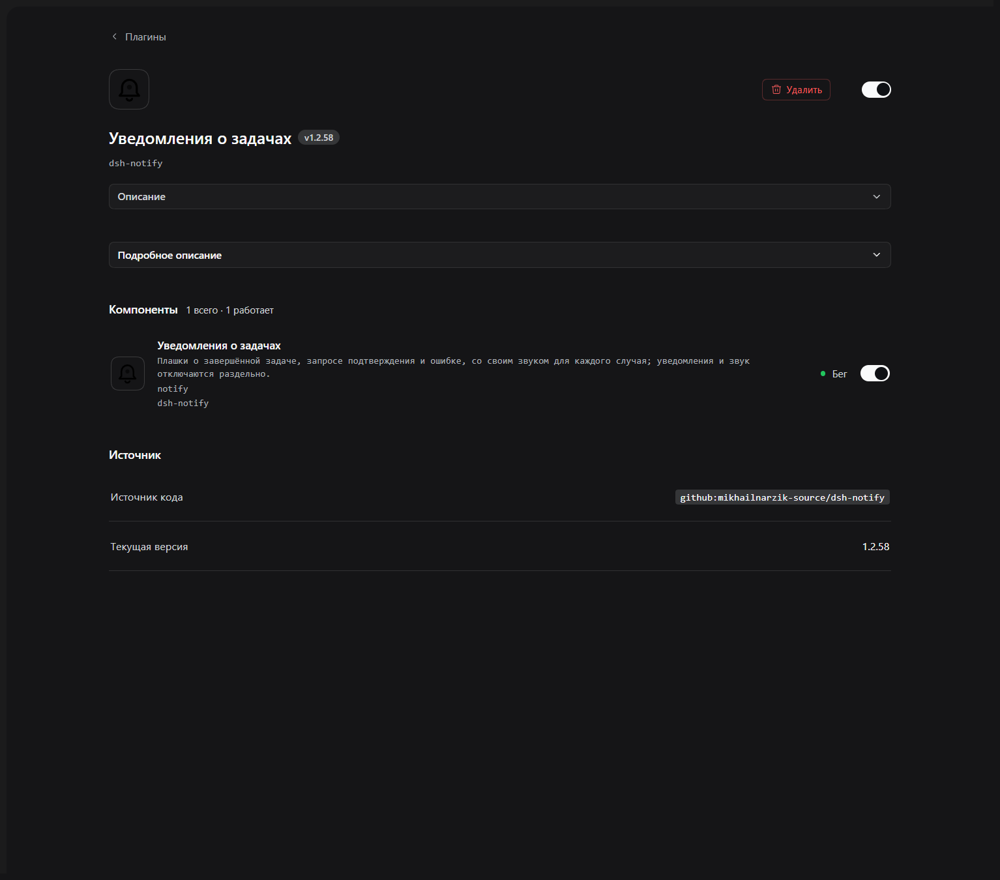

# Уведомления о задачах — подробное описание

Плагин `dsh-notify` показывает всплывающие плашки (тосты) о событиях в
DeepSeek Harness и подаёт звуковой сигнал. Этот файл — подробная версия
руководства: те же шаги, но с разбором каждого элемента, всех настроек и
типичных ошибок. Краткая версия — в `README.md` плагина.

## Что это и зачем

Агент выполняет задачу минуты, и всё это время нет смысла смотреть в окно
Harness. Плагин сам сообщает о трёх событиях:

| Событие | Плашка | Когда бывает |
| --- | --- | --- |
| Задача завершена | зелёная, «Задача завершена» | ход агента закончился; в строке — название сессии и время работы |
| Нужно ваше действие | жёлтая, «Нужно ваше действие» | агент просит подтвердить вызов инструмента, ждёт ответа на вопрос, проверки плана или разрешения после остановки хода |
| Ошибка | красная, «Произошла ошибка» | ход сорвался или ответ оборван по лимиту длины |

Термины:

- **тост / плашка** — небольшое окно в углу поверх интерфейса, исчезает само;
- **сессия** — один диалог в DSH (список диалогов слева);
- **субагент** — помощник, которого агент запускает внутри задачи; его
  завершение тоже приходит отдельной плашкой с бейджем «субагент»;
- **фокус** — окно, с которым вы работаете; «не в фокусе» = свёрнуто или
  закрыто другим окном;
- **нативная карточка** — отдельное окно Windows поверх всех программ (см.
  раздел «Что вы увидите»).

Зачем: не проверять Harness каждые полминуты; событие само напомнит о себе
звуком и плашкой.

## Как открыть

1. Нажмите **Настройки** (шестерёнка).
2. В списке разделов настроек выберите **«Уведомления»** — раздел подписан
   иконкой **колокольчика**. Это единственное место, где меняются плашки, звук,
   тема и проверяются обновления.
3. В **«Настройки → Плагины»** есть карточка **«Уведомления о задачах»**: внутри
   описание, версия и кнопка «Подробнее», которая открывает этот файл.
4. Сами плашки отдельно открывать не нужно: они появляются поверх любого
   экрана приложения, когда происходит событие.

Собственная панель в левой панели — самый короткий путь к настройкам: клик по
строке **«Уведомления»** открывает страницу плагина целиком, без описания,
источника и версии из плагин-менеджера. Строка показывается, только пока панель
закреплена; откреплённая остаётся в меню **«Ещё»**, откуда её возвращают
кнопкой закрепления. Видимостью и закреплением управляет плагин
**«Оформление интерфейса»**; изменения применяются сразу, без перезагрузки.

## Как пользоваться пошагово

Сценарий: узнать о завершении задачи, пока вы работаете в другом окне.

1. **Настройки → Уведомления**. Убедитесь, что «Показывать уведомления» и
   «Звуковые уведомления» включены, «Громкость» не на нуле.
2. Найдите раздел **«Проверка»**.
3. Нажмите **«Завершение»**.
   **Результат:** в углу появляется зелёная плашка «Задача завершена» и звучит
   мягкий сигнал. Это проверка: звук, показ и оформление работают.
4. По желанию нажмите там же **«Поверх всех окон» → «Показать»**.
   **Результат:** появится отдельная карточка поверх всех программ — так она
   выглядит, когда Harness свёрнут.
5. Вернитесь в чат, дайте агенту короткое задание и переключитесь в другую
   сессию или сверните окно.
6. Дождитесь завершения: в углу появится плашка (или карточка поверх окон, если
   окно свёрнуто), прозвучит звук.
7. Нажмите **«Перейти»** на плашке.
   **Результат:** окно Harness поднимается, открывается нужная сессия, плашка
   закрывается.

Дополнительно: кнопка с колокольчиком на плашке выключает звук на 15 минут, а
повторное нажатие возвращает его. Удобно, если вы на созвоне.

## Примеры

Команды агенту:

- «Собери список файлов в `src` и подожди моего подтверждения перед
  удалением» → жёлтая плашка «Нужно ваше действие» с названием инструмента.
- «Запусти тесты и вернись с результатом» → зелёная плашка по завершении.
- «Запусти двух субагентов: один делает ревью, второй пишет тесты» → две плашки
  с бейджем «субагент».
- «Проверь сборку; если упадёт — покажи ошибку» → при сбое красная плашка.

Сценарии настроек:

| Задача | Что настроить |
| --- | --- |
| Плашки должны висеть, пока я не закрою | «Сколько висит» → «Не скрывать» |
| Не мешать игре | «Игровой режим» → включить |
| Плашки в другом углу | «Угол экрана» |
| Заметно крупнее текст | «Размер текста» → «Крупный» / «Очень крупный» |
| Тихий сигнал громче | «Громкость» → до 200% |
| Уведомление, когда Harness свёрнут в трей | «Системные уведомления» → «Показывать в системе» и «Разрешить» |

## Что вы увидите

Плашка появляется, только если вы не читаете именно ту сессию, где произошло
событие, или окно приложения не в фокусе. Звук звучит всегда — даже когда вы в
этой сессии. Когда вы открываете сессию, о которой сообщила плашка, её плашка
закрывается сама.

### Плашка (тост)

- Цветная полоса и иконка слева; цвет зависит от типа события.
- Заголовок: «Задача завершена», «Нужно ваше действие», «Произошла ошибка».
- Строка подробностей: название сессии и время работы («за 2 мин»); для
  запроса подтверждения — название инструмента; для повторов — счётчик.
- Кнопки: **«Перейти»**, **колокольчик** (звук на 15 минут) и круглый **✕**.
- Внизу тонкая полоса — таймер обратного отсчёта до автоматического скрытия.
- Стек: одновременно видно не больше трёх плашек; новая плашка той же сессии
  заменяет старую. Плашка, появившаяся, пока окно было скрыто, ждёт вашего
  возвращения и не истекает «в пустоту».

### Колокольчик

Колокольчик — визитная карточка плагина. Он встречается в трёх местах:

1. иконка раздела **«Уведомления»** в настройках;
2. иконка карточки плагина в списке **«Плагины»**;
3. кнопка звука на плашке и на карточке поверх окон: обычный колокольчик —
   звук включён, перечёркнутый — приглушён на 15 минут.

### Карточки

Слово «карточка» здесь означает две разные вещи:

- **Форма плашки «Карточка»** — один из трёх вариантов вида: «Строка»
  (компактная одна строка), «Карточка» (заголовок и подробности, вариант по
  умолчанию), «Полоса» (широкая лента). Выбирается в «Оформление → Форма
  плашки», рядом сразу виден живой предпросмотр.
- **Карточка поверх всех окон** — отдельное окно, которое остаётся видимым
  поверх любых программ, когда Harness не в фокусе. Доступна на Windows; если
  нативная карточка недоступна (не Windows или компаньон не запустился), плагин
  откатывается к обычной плашке и системному уведомлению. Внутри: заголовок,
  текст, кнопки «Перейти» и **✕**, время и строка «висит 0:25», кнопка звука с
  обратным отсчётом приглушения («14:59»). Рисуется в выбранной теме и не
  перехватывает фокус без нажатия.

### Таймер

Таймеров в плагине три, и все они видны:

1. **Время показа плашки** — настройка «Сколько висит»: 4 с, 6 с, 10 с или
   «Не скрывать». На плашке показан полосой внизу.
2. **Время на экране у карточки поверх окон** — строка «висит 0:12»; карточка
   закрывается сама по истечении выбранного времени, а при «Не скрывать»
   остаётся до нажатия.
3. **Таймер приглушения звука** — 15 минут с обратным отсчётом на кнопке
   колокольчика (и на плашке, и на карточке).

### Игровой режим

Переключатель «Игровой режим» находится в разделе «Показ уведомлений». Пока он
включён, плагин не показывает ничего поверх экрана: ни плашки, ни карточку
поверх всех окон, ни системные уведомления Windows. Игра не теряет картинку, а
вы всё равно слышите звуковой сигнал — звук игровым режимом не отключается.
Проверка в настройках («Завершение», «Внимание», «Ошибка») при этом продолжает
работать, потому что это ручной вызов. Выключите режим, вернувшись к работе, —
плашки снова начнут появляться.

### История и обновления

- **«Недавние»** — 10 последних уведомлений с типом, текстом и временем. Клик
  по записи открывает связанную сессию; «Очистить» стирает список.
- **«Обновления»** — установленная версия, статус проверки, кнопки «Проверить
  обновления» и «Установить обновление», подсказка о перезапуске.

## Как это выглядит

*Рисунок 1. Страница плагина: описание, настройки и кнопки.*

*Рисунок 2. Рабочий раздел плагина: органы управления и результат.*

Страница «Уведомлений» собрана по общему каркасу плагинов DSH: центрированный
контейнер шириной до 960 px с отступами 24/28/40, шапка с иконкой 52 × 52 (🔔),
названием, подзаголовком, чипом («Плашки включены» или «Плашки выключены») и
кнопкой «Обновить» — она перечитывает настройки и историю. Ниже — карточки-секции
с акцентной полоской у заголовка: «Обновления», «Оформление», «Показ
уведомлений», «Звук», «Системные уведомления», «Предпросмотр» и «История». На
узком окне (до 760 px) отступы уменьшаются до 18/16/32, а элементы шапки
переносятся на новую строку. Все цвета берутся из токенов DSH, поэтому страница
сама подстраивается под светлую и тёмную тему.

Статус-чип в шапке оформлен как кнопка, а не пилюля: height 32 px, радиус 10 px,
`padding: 0 12px`, рамка 1 px, шрифт 600 12.5, `inline-flex` с `gap: 6` и
точка-индикатор 6 px слева. Заливка — мягкая, токеном по смыслу: success —
«Плашки включены», muted — «Плашки выключены». Счётчик «×N» и метка вида на
плашке тоже стали кнопочными (радиус 10 px, рамка 1 px), но остались компактными
(высота 22 px) — внутри строки заголовка тоста им не нужна высота 32 px.

## Частые ошибки и что делать

| Симптом | Причина | Решение |
| --- | --- | --- |
| Плашек нет совсем | выключен показ или включён игровой режим | включить «Показывать уведомления», выключить «Игровой режим» |
| Плашка есть, звука нет | выключен звук, громкость 0% или звук приглушён на 15 минут | проверить «Звуковые уведомления» и «Громкость»; нажать колокольчик на плашке, чтобы вернуть звук |
| Звук молчит в фоновой вкладке браузера | браузер не даёт играть звук без действия пользователя | один раз кликнуть или нажать клавишу в окне Harness — звук разблокируется |
| «Разрешение не выдано», уведомлений Windows нет | браузер не разрешил системные уведомления | «Системные уведомления» → «Разрешить»; проверить настройки уведомлений Windows |
| Карточка поверх окон не появляется | не Windows или окно Harness в фокусе | карточка доступна на Windows и показывается, когда окно не в фокусе; в фокусе вместо неё обычная плашка; при сбое компаньона — откат к плашке и системному уведомлению |
| В полноэкранной игре уведомлений нет | Windows их скрывает | включить «Игровой режим» — плашки отключатся, звук останется |
| Две одинаковые ошибки слились в одну плашку | плагин склеивает повторы за несколько секунд | так задумано |
| «Harness не ответил», версия «—» | работает старая host-часть: окно закрыто, а процесс в трее живёт | полностью закрыть Harness (трей → «Выход») и запустить снова |
| После установки обновления поведение старое | код подхватывается при старте | перезапустить DeepSeek Harness |
| «Перейти» открывает не ту сессию | сессия была удалена или переименована | открыть её вручную из списка сессий |

## Ограничения и безопасность

- Плашки живут внутри окна приложения. Поверх других программ их поднимает
  только нативная карточка — и только на Windows. Если Harness открыт только во
  вкладке браузера, поднимается эта вкладка.
- Без запущенного Harness уведомлений не будет: карточку запускает процесс
  приложения.
- Звук синтезируется в браузере (WebAudio), звуковых файлов нет; браузеру нужно
  хотя бы одно действие пользователя в окне, иначе он держит аудио на паузе.
- Плагин не читает текст диалога. В записи попадают только название сессии,
  тип события, название инструмента и короткие служебные фразы (лимит 240
  символов). Всё это не уходит в модель и не пишется в логи сессий.
- Настройки хранятся в профиле: `<DSH_HOME>/dsh-notify/settings.json` (по
  умолчанию `~/.dsh`), копия — в localStorage на случай недоступности профиля.
  История — в localStorage (10 записей). Журнал событий —
  `<DSH_HOME>/dsh-notify/log.jsonl`.
- Сеть используется только для проверки и скачивания обновлений с GitHub
  (`mikhailnarzik-source/dsh-notify`, ветка `main`). Никакой телеметрии.
- Плагин личный, предоставляется без гарантий, лицензия — свободная.

Требования: DeepSeek Harness 0.2.x с веб-клиентом (проверено на 0.2.2-rc.1),
браузер с WebAudio; для системных уведомлений — разрешение браузера. Внешних
зависимостей и шага сборки нет: чистый ESM.

## Связанные плагины

- **dsh-team** — панель «Команда» собирает задание для нескольких помощников;
  об их завершении сообщает именно dsh-notify (с бейджем «субагент»).
- **dsh-review** — ревью изменений и PR; плашки сообщат о результате, пока вы
  в другом окне.
- **dsh-compact** — локальная выжимка длинного диалога без нейросети.
- **dsh-sync** — синхронизация истории сессий между устройствами.
- **dsh-polish** — единое оформление кнопок и полей у всех плагинов.
